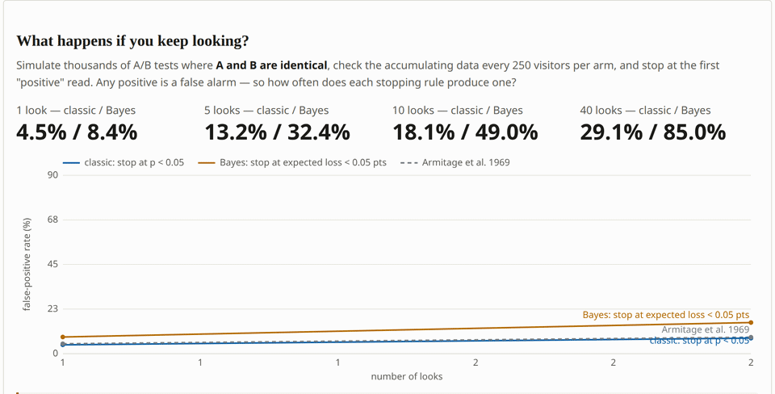
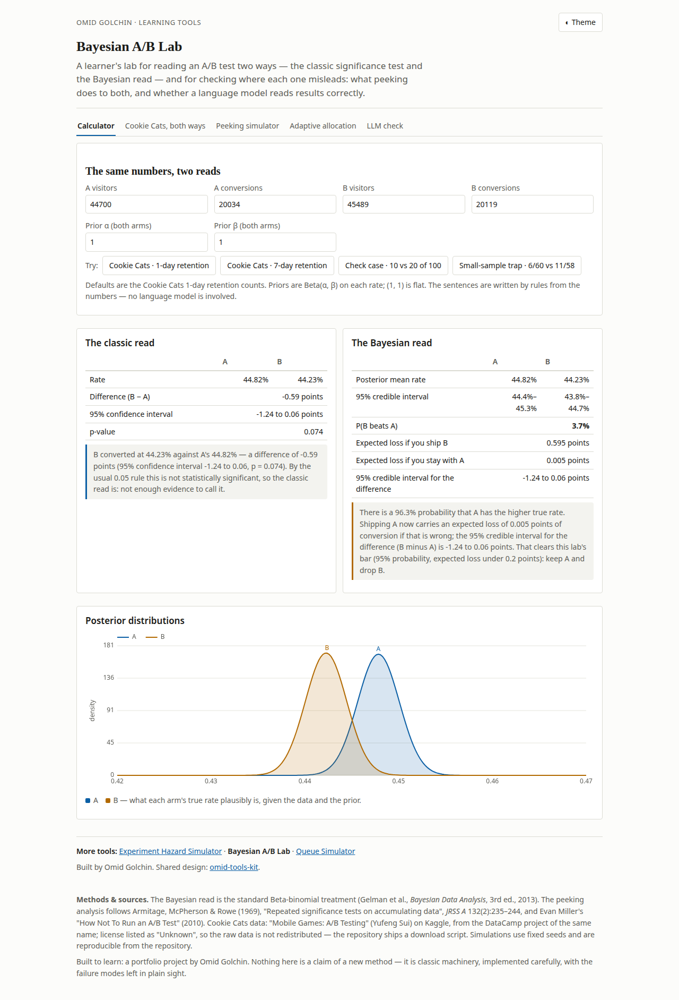

# Bayesian A/B Lab

A small lab for reading an A/B test two ways, the classic significance
test and the Bayesian read, built to find where each one misleads.

The surprise is in the peeking simulator. The Bayesian stopping rule,
checked every 250 visitors per arm and stopped as soon as the expected
loss of shipping the leader fell below 0.05 points, called a winner in
**85.0%** of tests where the two arms were identical. The classic rule,
stop at p < 0.05 and peeked at in exactly the same way, reached 29.1%.
The rule usually offered as the careful alternative manufactured
confident wrong answers nearly three times as often.

Nothing here is a new method. The Bayesian machinery is the standard
Beta-binomial treatment from Gelman et al.'s *Bayesian Data Analysis*;
the peeking analysis follows the repeated-significance-testing
literature back to Armitage, McPherson & Rowe (1969). The point of the
lab is the failure modes.





## The four parts

**1. The calculator.** Enter visitors and conversions (or load a
preset) and get two reads side by side. The classic read gives the
difference, a 95% confidence interval, and a p-value. The Bayesian
read gives the posterior distributions, P(B beats A), the expected
loss of shipping each version, and a 95% credible interval for the
difference, under Beta priors you can change. Under each read sits one
plain sentence, written by rules from the numbers, never by a language
model.

**2. The peeking simulator.** Thousands of simulated A/B tests where
A and B are *identical*, checked every 250 visitors per arm and
stopped at the first positive read, under two stopping rules: classic
(stop at p < 0.05) and Bayesian (stop when the expected loss of
shipping the leader falls below 0.05 points). The classic rule's
false-positive rate climbs from 4.5% with one look to 29.1% with 40
looks, close to Armitage et al.'s 1969 tabulation. The Bayesian rule
climbs much faster: 8.4% at one look and **85.0%** at 40. A fixed loss
threshold with unlimited peeking manufactures confident wrong answers
far more often than the classic test does. The fix is a sample size
fixed in advance, 3,839 visitors per arm to detect +2 points at 80%
power, then one look.

**3. Cookie Cats, both ways.** The published mobile-game A/B test
(gate at level 30 vs level 40; 90,189 players), read classically and
Bayesianly for 1-day and 7-day retention, with a bootstrap interval as
a distribution-free check. Gate_40 retained worse on both metrics:
1-day 44.23% vs 44.82% (−0.59 points; classic p = 0.074, P(gate_40
better) = 3.7%) and 7-day 18.20% vs 19.02% (−0.82 points; p = 0.0016,
P(gate_40 better) = 0.08%). The bootstrap interval agrees with both
parametric reads.

**4. The LLM check.** Thirty fixed A/B summaries (clear wins, ties,
small samples, borderline reads, and results that were peeked into
existence) put to two language models two ways: *Direct* (answer from
judgement: a decision, a probability, any concerns) and *Code* (write
Python that computes the answer; the code runs in a sandbox and is
scored, not trusted). Ground truth is this repo's calculator under a
decision rule fixed before the run (PLAN.md). By decision accuracy,
the best combination was Inkling-2-Small writing code: 0.96, with a
mean probability error of 1.2 points and 7 of 9 planted problems
flagged. gpt-oss-120b splits by metric. Its code mode decided better
than its direct answers (0.85 vs 0.73), but its direct probabilities
were far better calibrated (mean error 1.2 points, against 13.8 points
in code mode). On probability error alone the tightest answers were
Inkling's direct ones (0.1 points), though that mode decided worst of
the four (0.62) and 6 of its 30 replies came back empty. The failure
modes were specific: gpt-oss's code twice computed the *complementary*
probability and once hit the needle-posterior quadrature trap at
n = 100,000, while all six of Inkling's direct format failures were
empty replies on problem items, where its reasoning ran to the token
limit without answering.

## Headline results


Peeking, from 5,000 simulated test pairs with identical arms, checked
every 250 visitors per arm and stopped at the first positive read:

- Classic rule (stop at p < 0.05): false-positive rate 4.5% with one
  look, 29.1% with 40 looks.
- Bayesian rule (stop when the expected loss of shipping the leader
  falls below 0.05 points): 8.4% with one look, 85.0% with 40 looks.
- Fixed in advance instead: 3,839 visitors per arm detects a +2 point
  difference at 80% power, with a single look at the end.

The full computed write-up is in
[results/summary.md](results/summary.md).

## What I learned

- A Bayesian stopping rule is not protection against peeking. With a
  fixed expected-loss threshold and unlimited looks it produced more
  false positives than the classic test, not fewer (85.0% against
  29.1% at 40 looks). Optional stopping is a design problem, not a
  school-of-statistics problem.
- My first grid computation of the difference distribution ran in the
  wrong direction: it integrated the survival function where the CDF
  belonged, and put the credible interval's low end at the edge of the
  grid. The JavaScript version had the same bug. What caught it was
  the tests that check the two implementations against each other and
  both against Monte Carlo.
- The empty answers in the LLM pilot were a budget problem, not a
  model problem. At 1,200 tokens the reasoning models spent the whole
  budget thinking and returned nothing; at 4,000 the same models
  answered. Only one model finished the first pilot. The fix was a
  number in the config, applied to every model before the freeze.
- Scoring problem-flagging by keyword match is generous. A model can
  earn the flag with a stock phrase, so the score says the words
  appeared, not that the model understood the problem. The summary
  reports it as the mechanical proxy it is.

## Run it

```bash
make setup                 # venv + pinned dependencies
make data                  # download the Cookie Cats CSV (not redistributed; see DATA_SOURCES.md)
make test                  # the spec's checks: Monte Carlo agreement, one-look FPR, JS/Python parity
make analyze               # regenerate results/ and the playground's data files
make serve                 # playground at http://localhost:8000
```

The LLM check can be re-run (it is resumable and skips completed
calls) with:

```bash
.venv/bin/python -m src.bayesab.run \
  --models openai/gpt-oss-120b thinkingmachines/Inkling-2-Small
```

It needs a Together AI API key in `TOGETHER_API_KEY` (or a local
`.env`; both are git-ignored). Model selection followed the rule in
PLAN.md: the two cheapest models, from different families, that
answered all five pilot items in the required format. Eleven models
were piloted; the table of near-misses is in PLAN.md and is worth
reading on its own.

## Layout

- `src/bayesab/stats.py`: the calculator (exact formulas; fitted-grid
  computation for large samples, checked against the exact ones)
- `src/bayesab/simulate.py`: peeking and Thompson-sampling simulations
- `src/bayesab/cookiecats.py`: the Cookie Cats analysis
- `src/bayesab/items.py`: the 30 LLM-check summaries and ground truth
- `src/bayesab/run.py` / `score.py` / `sandbox.py`: the LLM check
- `docs/`: the playground (plain HTML/JS; maths in `abmath.js`,
  tested against the Python)
- `PLAN.md`: the frozen plan. `FREEZE_MANIFEST.txt`: its hashes
- `DECISIONS.md`: every judgement call, logged. `SPEND.md`: costs

## Limitations

- Conversion-type (Bernoulli) metrics only; one real dataset.
- The grid computation used at large sample sizes is accurate to
  plotting tolerance, not to the last decimal; the exact path is the
  reference and the tests bind the two together.
- Problem-flagging in the LLM check is scored by keyword match on the
  model's stated concerns, a generous, mechanical proxy, reported
  as one.
- Two models, one run each per item, at temperature 0.7: the LLM
  check shows how these models did on these items, not a ranking of
  models in general.

## References

1. Gelman, A., Carlin, J. B., Stern, H. S., Dunson, D. B., Vehtari,
   A., & Rubin, D. B. (2013). *Bayesian Data Analysis* (3rd ed.).
   Chapman and Hall/CRC.
2. Armitage, P., McPherson, C. K., & Rowe, B. C. (1969). Repeated
   significance tests on accumulating data. *Journal of the Royal
   Statistical Society, Series A*, 132(2), 235–244.
3. Miller, E. (2010). How not to run an A/B test. evanmiller.org.
4. Cookie Cats data: "Mobile Games: A/B Testing" (Yufeng Sui),
   Kaggle / DataCamp project 184. License listed as "Unknown"; see
   [DATA_SOURCES.md](DATA_SOURCES.md).

## License

MIT (code). The Cookie Cats dataset is not covered by this license
and is not redistributed here.
