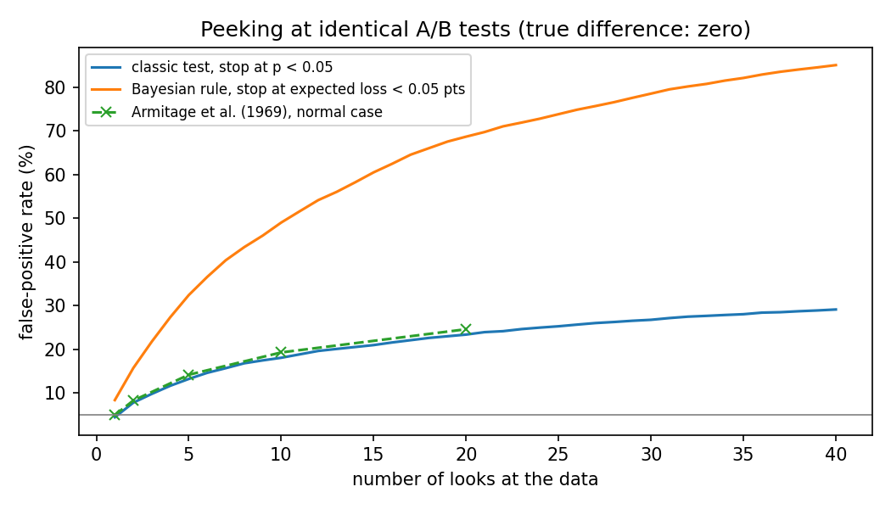

# A/B Test Decision Tool

For anyone who has run an A/B test and has to decide what to do next: enter visitors and conversions for each version and get a verdict you can defend (**ship**, **keep testing**, or **stop: no meaningful difference**), plus a planner for how long a new test needs to run.


**Use it:** https://omidgolchin.github.io/bayesian-ab-lab/ (runs in your browser; nothing you type leaves it)

## What it does

- **Analyze my test.** Four numbers in, one verdict out, in plain words, with the lift, the chance B is better and the evidence behind it. Optional: how many times you checked the results, how long it ran, the value of a conversion (turns the lift into dollars per 10,000 visitors).
- **Plan a test.** Your conversion rate, the smallest lift worth detecting and your daily traffic give the visitors per version and a run length in whole weeks, with a chart of what a longer test buys.
- **Fill from my notes.** Paste a dashboard export or a Slack thread; a language model (your key, or copy the prompt into any assistant) fills the form, showing the phrase each number came from. The model never sees or produces the verdict.
- **Copy summary / Copy link.** A plain-text summary for Slack or email, and a link that reopens the tool with the same numbers.

## Built-in checks

| Check | What it catches |
|---|---|
| Traffic split | Visitor counts that do not match the planned split (sample ratio mismatch): usually a tracking or assignment bug that biases everything else. The verdict becomes "Don't trust this test yet." |
| Peeking | If you looked at the results more than once, a plain p-value is fooled far more often than 5% (about 20% after 12 looks). The tool switches to an always-valid p-value. |
| No meaningful difference | An equivalence test, so "stop, the difference is too small to matter" is a verdict, not a shrug. |
| Sample size | Too few conversions for the approximations to hold. |
| Test length | Tests shorter than a week, or not in whole weeks, over- or under-represent weekdays. |
| Several versions (planner) | Comparing more than one variant with the original splits the significance level (Bonferroni) and raises the sample size. |

## Design decisions

- **Ship needs both reads to agree.** The leader ships only if its chance of being better clears the bar (default 95%), its expected loss is under 10% of the smallest lift worth acting on (a "threshold of caring"), *and* the classic evidence is significant. A Bayesian rule alone can be peeked into false wins (see Research notes); a p-value alone says nothing about how costly a wrong call is.
- **Always-valid p-value for repeated looks.** The mixture sequential probability ratio test (Johari, Koomen, Pekelis & Walsh 2022), the method behind commercial "check any time" testing. Its mixing scale is set to the smallest lift worth acting on. In this repo's simulation of 2,000 identical-arm tests checked 40 times, it raised a false alarm in under 5% (tested), against 29% for a plain p-value.
- **Sample ratio mismatch at p < 0.001.** The conventional threshold in large-scale experimentation (Kohavi, Tang & Xu 2020, ch. 21): strict enough not to cry wolf on every test, and a real mismatch is usually far below it.
- **Equivalence by two one-sided tests.** "No meaningful difference" requires the 90% interval to sit inside ± the smallest worthwhile lift (Schuirmann 1987); a non-significant result alone is not evidence of no difference.
- **Run length in whole weeks.** Weekday and weekend visitors behave differently; a test that ends mid-week over-weights some days.
- **A skeptical prior is one click away.** It treats both versions as if each had 1,000 prior visitors at the overall rate, which stops tiny samples from producing huge lifts.
- **The AI assist only reads.** It fills inputs from messy text and must quote its source for each value; values whose quote is not found in your text are left unticked.

## Validation

- **31 tests** (`make test`): the Bayesian read against brute-force Monte Carlo; the JavaScript against the Python reference on fixed cases; sample ratio mismatch against `scipy.stats.chisquare`; the sample-size formula against the textbook case (3,841 per arm for 10% to 12%); the always-valid p-value's false-alarm rate under 40 looks; equivalence on constructed cases; the AI assist's prompt and reply handling.
- **AI assist extraction:** a 20-item test set of realistic notes (`assist/testset.json`: Slack threads, dashboard exports, rates without counts, uneven splits, three versions, text with no numbers). Score any model with `ANTHROPIC_API_KEY=... node scripts/eval_assist.js`; results go to `results/assist_eval.json`. Not yet run for this release.
- Checked on desktop and phone widths, in light and dark themes.

## What I learned

- A Bayesian stopping rule is not protection against peeking. With a fixed expected-loss threshold and unlimited looks it produced more false positives than the classic test, not fewer (85.0% against 29.1% at 40 looks). That is why the tool asks how many times you looked.
- The most useful verdict turned out to be the one most calculators never give: "stop, the difference is too small to matter."
- My first grid computation of the difference distribution ran in the wrong direction. What caught it was the tests that check the JavaScript and Python against each other and both against Monte Carlo.
- A broken traffic split is the most common way real tests go wrong, and it is invisible unless you check for it.

## Research notes

The experiments behind the tool, kept out of it on purpose. Full numbers in [results/summary.md](results/summary.md).

- **Peeking breaks Bayesian rules too.** 5,000 simulated tests with identical arms, checked every 250 visitors per arm: false wins reached 29.1% for the classic rule and 85.0% for a Bayesian expected-loss rule after 40 looks. 
- **Cookie Cats, read both ways.** Moving the game's first gate from level 30 to level 40 lowered 7-day retention by 0.82 points (p = 0.0016; P(level 40 better) = 0.08%). Both reads agree.
- **Adaptive allocation.** Thompson sampling earned more conversions during a simulated test than a 50/50 split (464 vs 440 of 4,000), but reached a confident, correct final read less often (52.5% vs 65.2%).
- **Can a language model read an A/B result?** 30 test summaries, two open models, asked directly or asked to write code. Writing code gave better ship/keep decisions for both models; one model's code answers still missed the probability badly. A small check (two models), not a ranking.

## Run it

```bash
make setup                 # venv + pinned dependencies
make data                  # download the Cookie Cats CSV (not redistributed; see DATA_SOURCES.md)
make test                  # all checks, including JS/Python agreement
make analyze               # regenerate results/ (research notes) and docs/data/peeking.json
make serve                 # the tool at http://localhost:8000
```

The LLM check can be re-run (it is resumable and skips completed
calls) with:

```bash
.venv/bin/python -m src.bayesab.run \
  --models openai/gpt-oss-120b thinkingmachines/Inkling-2-Small
```

It needs a Together AI API key in `TOGETHER_API_KEY` (or a local
`.env`; both are git-ignored). Model selection followed the rule in
PLAN.md: the two cheapest models, from different families, that
answered all five pilot items in the required format. Eleven models
were piloted; the table of near-misses is in PLAN.md and is worth
reading on its own.

## Layout

- `docs/`: the tool (plain HTML and JavaScript, no build step). `decide.js` holds the verdict rules, `abmath.js` the classic and Bayesian reads, `tool-common.js` and `tool.css` the shared tool kit, `assist-config.js` the AI assist's prompt.
- `src/bayesab/decide.py`: the reference implementation of the verdict rules; `stats.py`: the reads; the rest: the research-notes experiments.
- `assist/` and `scripts/eval_assist.js`: the assist's test set and scorer.
- `PLAN.md`, `FREEZE_MANIFEST.txt`, `DECISIONS.md`, `SPEND.md`: the frozen plan, its hashes, every judgment call and the costs of the research-notes experiments.

## Limitations

- Conversion metrics (converted or not) only; revenue per visitor and other continuous metrics need a different test.
- Two versions in the analyzer; the planner handles up to four.
- The always-valid p-value uses a normal approximation, so it is conservative at small samples (the small-sample check flags those).

## References

1. Gelman, A., Carlin, J. B., Stern, H. S., Dunson, D. B., Vehtari,
   A., & Rubin, D. B. (2013). *Bayesian Data Analysis* (3rd ed.).
   Chapman and Hall/CRC.
2. Armitage, P., McPherson, C. K., & Rowe, B. C. (1969). Repeated
   significance tests on accumulating data. *Journal of the Royal
   Statistical Society, Series A*, 132(2), 235–244.
3. Miller, E. (2010). How not to run an A/B test. evanmiller.org.
4. Johari, R., Koomen, P., Pekelis, L., & Walsh, D. (2022). Always valid inference: Continuous monitoring of A/B tests. *Operations Research*, 70(3), 1806–1821.
5. Kohavi, R., Tang, D., & Xu, Y. (2020). *Trustworthy Online Controlled Experiments*. Cambridge University Press.
6. Schuirmann, D. J. (1987). A comparison of the two one-sided tests procedure and the power approach for assessing the equivalence of average bioavailability. *Journal of Pharmacokinetics and Biopharmaceutics*, 15(6), 657–680.
7. Fleiss, J. L., Levin, B., & Paik, M. C. (2003). *Statistical Methods for Rates and Proportions* (3rd ed.). Wiley.
8. Cookie Cats data: "Mobile Games: A/B Testing" (Yufeng Sui),
   Kaggle / DataCamp project 184. License listed as "Unknown"; see
   [DATA_SOURCES.md](DATA_SOURCES.md).

## License

MIT (code). The Cookie Cats dataset is not covered by this license
and is not redistributed here.
